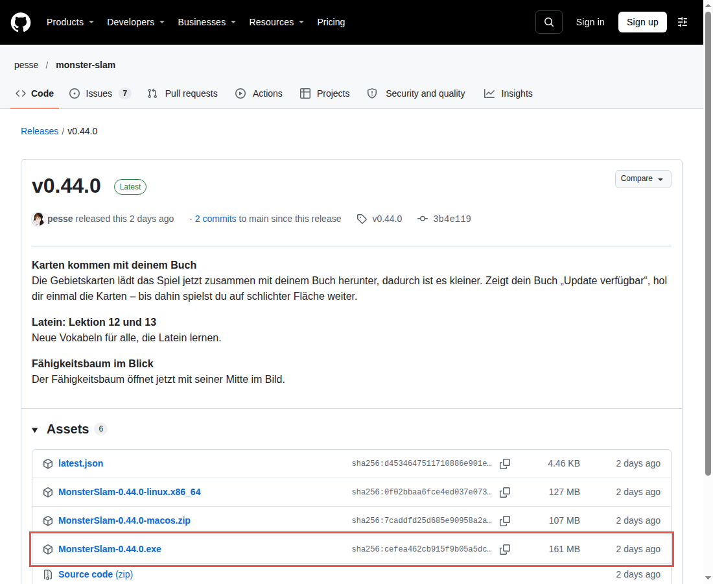

# Monster Slam unter Windows installieren

Monster Slam ist eine einzelne Datei, es gibt kein Setup. Herunterladen, in einen Ordner
legen, starten. Weil die Datei neu und nicht bei Microsoft registriert ist, warnen
Browser und Windows davor. Das ist bei kleinen Spielen normal. Unten steht, wie du
trotzdem weiterkommst.

## 1. Herunterladen

Öffne <https://github.com/pesse/monster-slam/releases/latest> und klicke unter
**Assets** auf **`MonsterSlam-<Version>.exe`** (rot markiert, etwa 160 MB).

### Wenn der Browser den Download blockiert

- **Edge** meldet „… wird nicht häufig heruntergeladen“ oder „konnte nicht überprüft
  werden“. Fahre mit der Maus über den Eintrag in der Download-Liste, klicke auf **„…“**
  und dann **„Beibehalten“**. Fragt Edge noch einmal nach: **„Mehr anzeigen“** →
  **„Trotzdem beibehalten“**.
- **Chrome** meldet „Verdächtige Datei“ oder „Unsichere Datei“. Klicke in der
  Download-Liste auf den Pfeil neben der Datei und dann auf **„Trotzdem herunterladen“**
  bzw. **„Behalten“**.

## 2. Einen Ordner wählen

Verschiebe die EXE aus „Downloads“ in einen eigenen Ordner, zum Beispiel
`Dokumente\Monster Slam`. Der Ordner muss dir gehören (nicht „Programme“), sonst kann
sich das Spiel später nicht selbst aktualisieren.

Eine Verknüpfung auf dem Desktop: Rechtsklick auf die EXE → (unter Windows 11 erst
„Weitere Optionen anzeigen“) → **„Senden an“ → „Desktop (Verknüpfung erstellen)“**.

## 3. Der erste Start: „Der Computer wurde durch Windows geschützt“

Beim ersten Doppelklick zeigt Windows (SmartScreen) einen blauen Kasten, in dem nur
„Nicht ausführen“ zu sehen ist.

1. Klicke auf den Link **„Weitere Informationen“**.
2. Jetzt erscheint **„Trotzdem ausführen“**. Klicke darauf.

Das kommt nur beim ersten Start, und nach jedem Update eventuell einmal wieder.

## 4. Wenn die Datei plötzlich verschwunden ist

Der Virenschutz (Microsoft Defender) hält Spiele, die mit der Godot-Engine gebaut sind,
manchmal fälschlich für gefährlich und verschiebt sie in die Quarantäne. Dann ist die
EXE weg, und unten rechts erschien kurz eine Meldung „Bedrohung gefunden“.

1. Öffne **Windows-Sicherheit** (Startmenü, „Sicherheit“ tippen).
2. **Viren- & Bedrohungsschutz** → **Schutzverlauf**.
3. Den Eintrag mit `MonsterSlam` anklicken → **Aktionen** → **Zulassen** (oder
   „Wiederherstellen“).

Danach liegt die Datei wieder im Ordner.

## 5. Vokabeln holen

Das Spiel selbst enthält keine Vokabeln. Auf dem Start-Screen unter **„Inhalte“** das
eigene Buch auswählen und **„Ausgewählte holen“** klicken; manche Bücher brauchen einen
Zugangscode. Mehr dazu im Handbuch im Spiel, Kapitel 15.

## Updates

Neue Fassungen meldet das Spiel beim Start selbst („⬆ Update auf …“) und ersetzt sich
nach einem Klick. Der Spielstand bleibt dabei erhalten; er liegt nicht im Spielordner,
sondern unter `%APPDATA%\Godot\app_userdata\Monster Slam\`.
